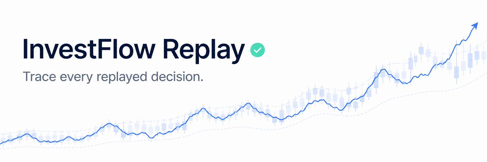
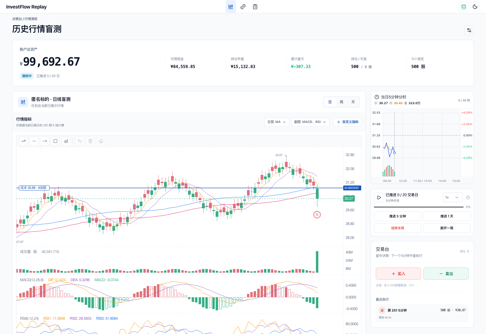
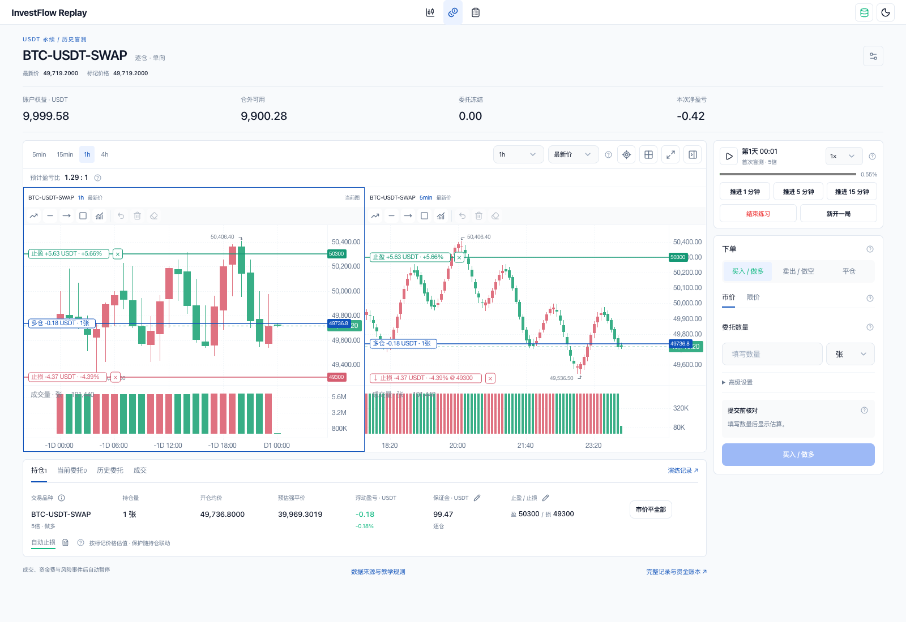

<div align="center">

# InvestFlow Replay

**先把交易规则放进可回放的训练场，再谈真实交易。**

A 股盲测与加密合约练习，在本机完成看图、模拟下单和复盘。保留首次判断，再用同场景复练对照自己的执行。



[在线介绍](https://dann-55.github.io/InvestFlow-Replay/) · [下载 Alpha](https://github.com/DaNN-55/InvestFlow-Replay/releases/tag/v0.1.0-alpha.1) · [正式界面](#正式界面) · [快速开始](#快速开始) · [验证](#验证) · [边界与限制](#边界与限制)

</div>

---

## 这是什么

InvestFlow Replay 面向希望把交易判断练成具体行动的个人学习者。先看当前可见的 K 线，决定买卖、控制风险或继续等待；练习结束后，把当时的判断、实际模拟成交和事后复盘放在一起看。

以下介绍当前 `main` 分支的能力。已有 [v0.1.0-alpha.1 下载版本](https://github.com/DaNN-55/InvestFlow-Replay/releases/tag/v0.1.0-alpha.1)不代表包含全部主分支更新。

## 两条训练路径

| | A 股历史行情盲测 | 加密合约练习 |
| --- | --- | --- |
| 练什么 | 隐去标的身份，练习行情判断、仓位与执行 | BTC / ETH USDT 永续，练习方向、杠杆与风险 |
| 怎么看 | 日线演练，或日线背景 + 5 分钟执行；指标、绘图与持仓成本线 | 多周期单图／多图，十字线与视图联动；持仓、委托和止盈止损线 |
| 怎么下单 | 模拟委托与成交，日内支持限价和部分成交；按本局冻结规则执行 | 市价／限价，止盈止损；图上拖动先预览，确认后生效 |
| 数据条件 | 通达信日线与 5 分钟本地缓存 | 单独准备并校验冻结行情资产；安装脚本不包含行情包 |

两边共用紧凑的回放控制，可手动推进或调整自动播放倍率；图表只使用当前进度已揭示的行情，尚未完成的大周期 K 线随推进更新。你也可以不交易。

## 练完之后留下什么

- **判断与执行一起回看**：决策理由、模拟委托、成交、费用和账户变化保存在本地；统一交易追踪可查看两类演练并继续未完成的练习。
- **先记录，再揭晓**：揭晓前冻结原始判断；事后复盘与后续修正另行保留，不覆盖当时的记录。
- **首次与复练分开**：同场景可再次练习，首次成绩保留；对照记录帮助检查判断和执行的变化，单次成绩不证明策略有效。
- **修改先确认**：合约委托价格、剩余数量及止盈止损调整先显示预览，确认后生效；修改委托时可检查冻结资金变化和可用余额。

## 正式界面

以下为当前产品运行界面，使用隔离的合成样例数据，不含个人交易记录；图中结果仅用于说明操作。





更多界面与训练流程见[产品宣传主页](https://dann-55.github.io/InvestFlow-Replay/#evidence)。本地主页预览方式见[展示页](#展示页)。

## 快速开始

需要 Python 3.10–3.13 与 Node.js 22+。

当前为本地 Alpha，已在 macOS 上验收；其他系统尚未完成安装验收。首次下载：

```bash
git clone https://github.com/DaNN-55/InvestFlow-Replay.git
cd InvestFlow-Replay
```

```bash
./install.sh
./run.sh
```

打开 <http://127.0.0.1:5180/decision/market-replay>。首次进入会初始化通达信日线缓存；日内模拟使用 5 分钟缓存。

停止服务：

```bash
./stop.sh
```

### 加密行情数据准备

当前主分支的 OKX BTC/ETH USDT 永续训练需要单独准备冻结行情，`install.sh` 不下载该资产。没有行情时禁止新建，已有练习仍可从原账本恢复。请先按[数据准备指南](docs/crypto-data.md)离线导入小样或历史池并校验，再进入 `/decision/crypto-replay`。当前冻结资产仅在本地检出与备份中，尚无公开下载包。

### 自定义运行参数

启动脚本读取当前终端已导出的环境变量，不会自动加载根目录 `.env`。
`.env.example` 是可用变量的参考清单；例如在同一终端中执行：

```bash
export INVESTFLOW_REPLAY_ENGINE_PORT=8776
export INVESTFLOW_REPLAY_BACKEND_PORT=3111
export INVESTFLOW_REPLAY_WEB_PORT=5181
export INVESTFLOW_REPLAY_STORAGE_ROOT="$PWD/storage-local"
./run.sh
```

此例的页面地址为 <http://127.0.0.1:5181/decision/market-replay>。未导出的参数使用默认值；
自定义存储根同时影响行情缓存、应用账本和交易追踪文件。若同时设置
`INVESTFLOW_REPLAY_MARKET_DB_PATH`，日线行情库使用该显式路径，其他存储仍使用存储根。
同一套自定义存储参数也应在运行 `./install.sh` 初始化时使用。

`./run-demo.sh` 会覆盖当前终端中的 provider、存储根、运行状态目录和三个端口，使用它自己的离线演示配置；
演示配置优先于上述同名变量。停止正式服务用 `./stop.sh`，停止演示用 `./stop-demo.sh`。

## 离线演示

安装依赖后，用这一条命令启动完全离线的日线演练：

```bash
./run-demo.sh
```

打开 <http://127.0.0.1:5280/decision/market-replay>。页面会明确标注“离线合成数据”；可完成日线演练、模拟下单、推进、复盘、刷新恢复与历史查看。Demo 使用确定性的合成指数和标的，不连接通达信；会话、订单、复盘和交易追踪账本写入项目内独立的 `.demo-storage/`，不会读取或修改正式 `storage/`。

离线 Demo 只支持 20 / 60 / 120 个交易日的日线演练；日内模拟、合约练习和真实行情不在此入口提供。停止 Demo：

```bash
./stop-demo.sh
```

如需清空 Demo 的会话与账本，先停止后执行 `./reset-demo.sh`。它只删除 `.demo-storage/`。

第一次试用建议先完成一次离线演练：观察行情 → 模拟买卖并推进 → 提交盲评 → 揭晓 → 保存复盘 → 在历史演练中查看结果。

## 展示页

只预览产品介绍，不启动行情服务：

```bash
npm ci --prefix web
npm run build --prefix web
npm run preview --prefix web
```

打开 <http://127.0.0.1:4180/landing/>。页面为独立静态入口，不调用行情 API；这里的安装按钮指向仓库，不是免安装在线交易台。

## 本地系统边界

| 层          | 实现              | 责任                                  |
| ----------- | ----------------- | ------------------------------------- |
| Web         | Vue 3 + Vite      | 演练配置、K 线、下单、复盘与交易追踪  |
| Backend     | Node.js           | API、演练生命周期、订单事件和账本边界 |
| Engine      | Python + FastAPI  | 行情准备、解析、缓存和演练场景创建    |
| Market data | 通达信 / pytdxdata；OKX 冻结资产 | A 股缓存与合约历史行情、标记价格、资金费率 |
| Storage     | DuckDB + SQLite   | 行情缓存与应用账本分离                |

运行时数据不提交到仓库：`storage/market/` 保存行情缓存，`storage/app/` 保存演练、订单、复盘和策略账本。

交易追踪文件位于 `storage/trade-records/`。备份前先用 `./stop.sh` 停止正式服务，再复制整个 `storage/`；恢复时保持服务停止，将备份恢复至同一路径。使用自定义存储目录时备份实际目录。演示数据独立位于 `.demo-storage/`。

## 验证

```bash
PYTHONPATH=engine .venv/bin/python -m pytest engine/tests
npm test --prefix backend
npm run test:unit --prefix web
npm run test:e2e --prefix web
npm run lint --prefix web
npm run build --prefix web
```

## 边界与限制

- 这是个人研究和模拟演练工具，不构成投资建议；模拟结果不能等同于真实收益。
- 在线模式依赖通达信服务与本地缓存覆盖；退市证券和 5 分钟行情的可用性不由本项目控制。
- 合约练习采用冻结规则与教学撮合、费用和接管模型，不等同于 OKX 实盘清算；完整数据与导入条件见[合约数据指南](docs/crypto-data.md)。
- 离线 Demo 为合成数据，仅支持 A 股日线流程，不能据此判断真实市场、证券或收益。
- 浏览器 E2E 中有部分 API mock，用于固定前端交互契约；它们不冒充完整三层集成验证。

## 反馈

遇到无法继续或看不懂的步骤，请通过 [Issues](https://github.com/DaNN-55/InvestFlow-Replay/issues) 反馈，附系统、版本、操作步骤和错误文字。请勿上传个人账本或未脱敏日志。

## 许可证

本项目采用 [Apache License 2.0](LICENSE)。第三方依赖遵循各自许可证。

## 来源

InvestFlow Replay 从 [InvestFlow](https://github.com/DaNN-55/InvestFlow) 独立拆出。AI Coding 工具参与部分实现；产品规则、数据流程、任务拆解、测试验收和迭代由项目作者负责。
